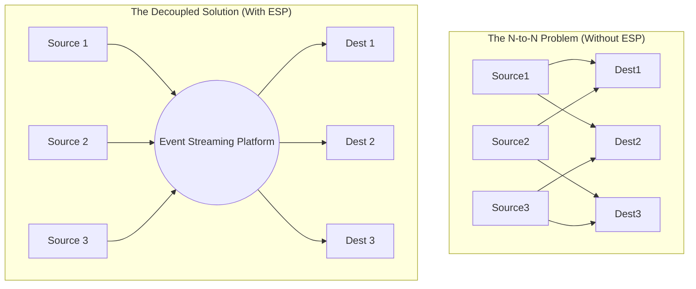
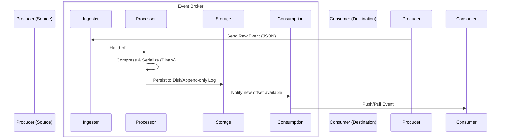

# Module 4, lecture 1: distributed event streaming platform components

## 1. The anatomy of an event

In system architecture, an **event** is an immutable record indicating that "something worth noticing has happened." More formally, it is a data point describing an entity's observable state update at a specific point in time.

Because events are immutable (they represent history, which cannot be changed), they are ideal for distributed systems where state must be reconstructed or audited.

### 1.1 Common event formats

Events can range from simple scalar values to complex nested structures. Modern data engineering typically categorizes them into three formats.

Below are C# representations using `record` types, which are perfectly suited for events due to their inherent immutability and value-based equality.

**A. Primitive Type**
The simplest form of an event, carrying only a raw value (e.g., plain text, a number, or a boolean).

```csharp
// Example: A raw temperature reading without context.
public record PrimitiveEvent(double Value);

```

**B. Key-Value Format**
Provides context by associating a specific identifier (the key) with a state (the value). The value can be primitive or complex (JSON, XML, binary tuple).

```csharp
// Example: GPS coordinates tied to a specific vehicle.
public record GpsState(double Latitude, double Longitude);
public record CarGpsEvent(string CarId, GpsState Coordinates);

```

**C. Key-Value with Timestamp (Time-Series)**
Timestamped events add the temporal context needed for out-of-order delivery, windowing, and time-series analysis.

```csharp
// Example: Blood pressure reading with temporal context.
public record BloodPressureMeasurement(int Systolic, int Diastolic);
public record PatientVitalsEvent(
    string PatientId,
    BloodPressureMeasurement Vitals,
    DateTimeOffset Timestamp
);

```

---

## 2. The "N-to-N" integration problem

Event streaming is the continuous transportation of these events from a source (sensors, databases, applications) to a destination (data warehouses, file systems, other applications).

In a naive architecture, engineers might build direct ETL pipelines between every source and destination using various protocols (HTTP, FTP, JDBC). As the system scales, this results in an unmaintainable "spaghetti" architecture.

### Architectural comparison



To solve the $O(N^2)$ complexity of direct connections, we introduce an intermediary layer.

---

## 3. Event streaming platform (ESP) architecture

An ESP is a scalable, fault-tolerant layer between data producers and consumers. It decouples them and provides an interface for event-based ETL.

### 3.1 Core components of an ESP

| Component                 | Description                            | Technical Responsibility                                                                                          |
| ------------------------- | -------------------------------------- | ----------------------------------------------------------------------------------------------------------------- |
| **Event Broker**          | The message-routing component of the ESP. | Handles the ingestion, processing, and routing of data streams.                                                   |
| **Event Storage**         | The persistence layer.                 | Buffers events to disk or memory, allowing consumers to process data at their own pace without dropping messages. |
| **Query/Analytic Engine** | The computation layer.                 | Allows for real-time aggregations, filtering, and windowing directly on the stream (e.g., ksqlDB).                |

### 3.2 Deep dive: the event broker

The Event Broker is the engine of the platform and is generally divided into three sub-routines:

1. **Ingester:** Efficiently accepts high-throughput incoming connections from varied sources.
2. **Processor:** Executes middleware logic such as:

- _Serialization/Deserialization_ (e.g., converting C# objects to Protobuf or Avro).
- _Compression/Decompression_ (e.g., Snappy, Gzip) to reduce network payload.
- _Encryption/Decryption_ (TLS/SSL).

3. **Consumption (Dispatcher):** Manages subscriber offsets and efficiently pushes or allows pulling of events to the destinations.



### 3.3 C# conceptual implementation of a broker interface

To understand how these components interact programmatically, consider this abstracted C# interface defining a basic broker's contract:

```csharp
using System.Threading.Tasks;
using System.Collections.Generic;

namespace StreamingPlatform.Core
{
    public interface IEventBroker<TEvent>
    {
        // 1. Ingestion: Receive an event and acknowledge receipt
        Task<bool> PublishAsync(string topic, TEvent eventData);

        // 2. Processing (Internal mechanism, often injected via middleware)
        // e.g., Task<byte[]> SerializeAndCompress(TEvent eventData);

        // 3. Consumption: Subscribe to a stream and process via a callback
        Task SubscribeAsync(string topic, string consumerGroupId, Func<TEvent, Task> onMessageReceived);
    }
}

```

---

## 4. The industry landscape

While the architectural principles remain consistent, various tools have been developed to handle ESP requirements, each with specific strengths:

- **Apache Kafka:** An open-source distributed commit log designed for high throughput and fault tolerance.
- **Amazon Kinesis:** AWS's fully managed real-time streaming service.
- **Apache Flink:** Highly focused on stateful computations and exact real-time stream processing (often paired with Kafka).
- **Azure Event Hubs:** Microsoft's fully managed, Kafka-compatible data streaming platform.
- **IBM Event Streams:** An enterprise-grade event streaming platform built on Apache Kafka.

This lecture examines distributed event-streaming components and the shift from batch ETL to continuous, asynchronous data flow.

---
