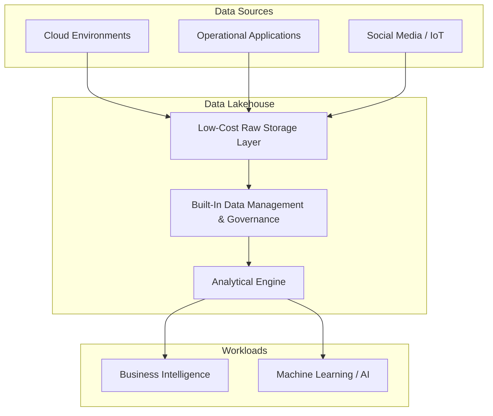

# Module 1, lecture 7: data lakes, data warehouses, and the data lakehouse

A commercial kitchen offers a useful analogy for data architecture: ingredients arrive from several sources, need different storage conditions, and must be prepared for use. Data lakes and warehouses handle different parts of that process. A lakehouse combines elements of both.

---

## 1. The kitchen analogy: from raw ingredients to insights

### 1.1 The loading dock — data ingestion

In a commercial kitchen, raw ingredients arrive on palettes from supplier trucks. They must be unwrapped, sorted, labelled, and routed to storage: pantries for dry goods, and walk-in fridges or freezers for perishables. Speed is critical: delays cause spoilage and waste.

In a data architecture, the equivalent is **data ingestion**—raw data arriving from diverse sources: cloud environments, operational applications, social media streams, IoT sensors. It arrives in different formats, at different velocities, and must be captured quickly before it loses value.

### 1.2 The pantry and freezer — storage and governance

Kitchen storage requires organization: FIFO (first in, first out) rotation, contamination separation, temperature controls. These controls help cooks work safely and find ingredients when they need them.

Similarly, data must be **cleaned, organized, and governed** in storage systems before it can be reliably consumed by downstream analytics.

---

## 2. Data lakes: the loading dock of data architecture

**Data lakes** provide a low-cost, high-speed repository for capturing raw data in all formats—structured, semi-structured, and unstructured. They serve the same function as the loading dock: get everything off the truck and into storage as quickly as possible.

### Challenges with data lakes

| Challenge                     | Description                                                                                                                                                       |
| ----------------------------- | ----------------------------------------------------------------------------------------------------------------------------------------------------------------- |
| **Data Governance & Quality** | Without rigorous governance, data lakes degrade into **data swamps**—filled with duplicate, inaccurate, or incomplete data that is difficult to track and manage. |
| **Data Staleness**            | Ungoverned data degrades over time, losing its value for generating insights—just as unused kitchen ingredients eventually spoil.                                 |
| **Query Performance**         | Data lakes are not optimized for complex analytical queries. Extracting insights directly from a lake can be slow and operationally difficult.                    |

---

## 3. Enterprise data warehouses: the organized kitchen

**Enterprise Data Warehouses (EDWs)** are the organized pantries and freezers of data architecture. Data arrives from a data lake or directly from operational applications. It is then cleaned, structured, and optimized for specific analytical tasks.

EDWs excel at powering:

- **Business Intelligence (BI) workloads** — dashboards, reports, and visualizations
- **Structured analytical queries** with high performance and concurrency

### Challenges with data warehouses

| Challenge                             | Description                                                                                                                               |
| ------------------------------------- | ----------------------------------------------------------------------------------------------------------------------------------------- |
| **High Cost**                         | Like enterprise-grade walk-in freezers, data warehouses are expensive to operate. Not everything can—or should—be loaded into one.        |
| **Limited Unstructured Data Support** | Warehouses have limited support for semi-structured and unstructured data—precisely the data types growing fastest in most organizations. |
| **Latency**                           | The time required to sort, clean, and load data into the warehouse can make it too slow for applications requiring the freshest data.     |

---

## 4. The data lakehouse: best of both worlds

Recognizing the complementary strengths and opposing weaknesses of data lakes and data warehouses, engineers developed a convergent architecture: the **data lakehouse**.

### 4.1 Core value proposition

The data lakehouse combines:

- **The flexibility and cost-effectiveness of a data lake** — store data from an exploding number of sources at low cost
- **The performance and structure of a data warehouse** — built-in data management and governance layers enable both BI and high-performance ML workloads

### 4.2 Adoption paths

Organizations can approach the data lakehouse through several routes:

- **Modernize existing data lakes** — layer governance and query optimization on top of current lake infrastructure
- **Complement existing data warehouses** — extend warehouse capabilities to support new AI and machine learning-driven workloads that require semi-structured and unstructured data

---

## 5. Comparative summary

| Dimension             | Data Lake                                       | Data Warehouse       | Data Lakehouse    |
| --------------------- | ----------------------------------------------- | -------------------- | ----------------- |
| **Cost**              | Low                                             | High                 | Moderate          |
| **Data Types**        | All (structured, semi-structured, unstructured) | Primarily structured | All               |
| **Governance**        | Weak (risk of data swamp)                       | Strong               | Strong (built-in) |
| **Query Performance** | Low for complex analytics                       | High                 | High              |
| **ML/AI Support**     | High (raw data access)                          | Limited              | High              |
| **BI Support**        | Limited                                         | High                 | High              |

---
